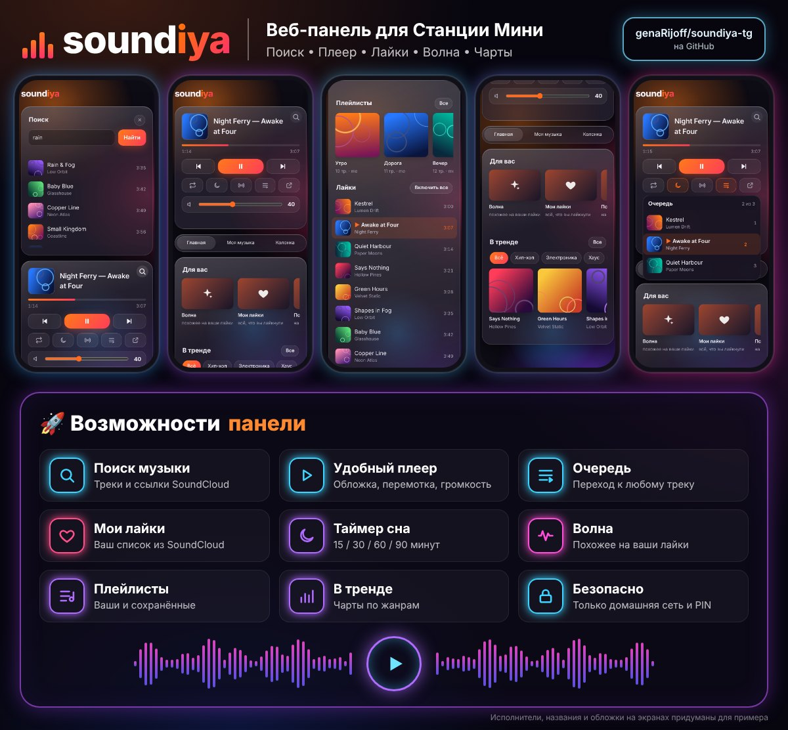

# soundiya-tg

> [!TIP]
> **💰 Поддержать проект** — донат на любой из адресов:
>
> | Сеть | Адрес |
> |---|---|
> | 💵 USDT · TRC20 | `TN2rQAsGNHQr8wnneKRD14UMX629D2Ca5q` |
> | 💵 USDT · ERC20 | `0x721845234eeC44e0a9BaE78402965828C1bc6c57` |
> | 🔸 USDT · TON | `UQCwj-RY2a4BH7sIDDeLb77XRaPDq0mb1FVwyC4UaOGbLMYy` |
> | 💎 TON | `UQCdQtJO4CF0Lyeb93X2zdeWeAcDJ-ieBC3AaL7LIqWfMBg3` |


Telegram-пульт для [soundiya](https://github.com/ShadowBlade83/soundiya) (SoundCloud голосом Алисы) на рутованной **Яндекс Станции Мини 1** (YNDX-0004). Бот работает прямо на колонке и сам ходит в Telegram: **входящих портов нет**.

- Карточка «что играет»: трек, прогресс, громкость, таймер сна; кнопки ⏮ ⏯ ⏭, ±15 с, 🔉/🔊 ±10, 🔁, 😴
- Очередь (до 25 треков): нажал номер — играет этот трек
- Название или ссылка soundcloud.com — найдёт и включит
- 🎙 Голосовое сообщение — колонка проиграет его: музыка встанет на паузу и продолжится после (до 1 минуты и 2 МБ). Тихие и громкие записи выравниваются до одного уровня; `/voicevol` — поправка, `/voice all` — разрешить слушателям
- Владелец и слушатели: друг пишет боту — тебе приходит запрос ✅/⛔
- 🗣 «Алиса, передай Маше, что я буду через час» — фраза придёт Маше в Telegram, Алиса подтвердит. Включается в `/admin`
- 🌐 Веб-панель в домашней сети: плеер, очередь, поиск, лайки, плейлисты, «Волна», чарты — с телефона или компьютера по PIN. Включается в `/admin`
- ⚙️ `/admin` — меню владельца: слушатели (голосовые, уведомления, удаление), режим и громкость голосовых, «передай», веб-панель, обновления
- Карточку со звуком получает тот, кто включил; `/notify on|off` у каждого свой
- Обновления soundiya: [форк](https://github.com/genaRijoff/soundiya/releases) сам собирает каждую новую версию автора с `STATE`, бот сообщает и ставит по кнопке

<details><summary>Скриншоты: бот</summary>
<p align="center">
  
  
</p>
</details>

> Нужна soundiya с командами `STATE`/`JUMP` (для «передай» — `MESSAGES`/`SAY`, с `v0.1.10-bot.3`; для веб-панели — `FIND`/`LIKES`/`PLAYIDS`, с `v0.1.10-bot.4`) — из [релизов форка](https://github.com/genaRijoff/soundiya/releases) (`v…-bot`): каждые 6 часов GitHub Actions переносит наши патчи ([`bot-api`](https://github.com/genaRijoff/soundiya/tree/bot-api)) на новую версию автора, гоняет тесты и выпускает релиз. Скрипт сборки берёт последний такой релиз.

## Что нужно

- Станция Мини 1 с root ([Station Mini Root](https://github.com/hertebeznat-cell/alice-station-1-mini-root)) и SSH или ADB
- Windows 10/11 с WSL (Debian) — для сборки; PowerShell — для установки
- Бот от [@BotFather](https://t.me/BotFather) и свой числовой id ([@userinfobot](https://t.me/userinfobot))

SSH к колонке настраивается один раз в `~\.ssh\config` на ПК (имя `station` используют скрипты):
```
Host station
    HostName <IP колонки>
    Port <порт SSH>
    User root
    IdentityFile ~/.ssh/<твой ключ>
```

## Сборка (WSL, 10–20 минут)

```powershell
git clone https://github.com/genaRijoff/soundiya-tg.git
cd soundiya-tg
wsl -d Debian -- bash scripts/build.sh
```
В `dist\` появятся `soundiya-mini1-bot-*.tar.gz` и `soundiya-tg-armv7-*.tar.gz`. Готовый `soundiya-mini1-bot-*.tar.gz` можно и просто скачать из релизов форка в `dist\`.

## Установка

```powershell
powershell -ExecutionPolicy Bypass -File .\windows\install-soundiya-build.ps1   # soundiya с STATE/JUMP
powershell -ExecutionPolicy Bypass -File .\windows\install-soundiya-tg.ps1      # бот
```
- Первый скрипт ставит soundiya и **выключает её автообновление**, иначе оно вернёт версию автора без `STATE`. Дальше обновления ставит бот: `/updates` или сообщение о новом релизе → **⬇️ Установить**. Файлы проверяет штатный автообновлятор колонки (SHA256, гудок, откат при сбое); вернуть прежнюю сборку — кнопкой.
- Второй при первой установке спросит токен (ввод скрыт, токен не покидает колонку) и твой id. Потом открой бота в Telegram и нажми **Start**.
- Без SSH, по USB: `install-soundiya-build.ps1 -Adb`.

## Управление (на колонке)

| Что | Команда |
|---|---|
| статус | `/data/opt/soundiya-tg/soundiya-tg check` |
| запустить / остановить / перезапустить | `/etc/init.d/S99soundiya-tg start` / `stop` / `restart` |
| лог | `tail -f /tmp/soundiya-tg.log` |
| заново ввести токен и id | `sh /data/opt/soundiya-tg/install.sh setup` |
| обновить | собрать заново и снова `install-soundiya-tg.ps1` (настройки сохраняются) |

## Удаление

```powershell
powershell -ExecutionPolicy Bypass -File .\windows\install-soundiya-tg.ps1 -Uninstall      # бот (настройки остаются)
powershell -ExecutionPolicy Bypass -File .\windows\install-soundiya-build.ps1 -Restore    # официальная soundiya + автообновление
```
Полностью, вместе с токеном и списком слушателей: на колонке `sh /data/opt/soundiya-tg/install.sh uninstall --purge`.

## Команды бота

| Команда | Кто |
|---|---|
| текст или ссылка soundcloud.com — найти и включить | все |
| `/now` `/queue` `/next` `/prev` `/pause` `/resume` | все |
| `/fav` `/top` `/trending [жанр]` `/related` `/playlist` | все |
| `/seek 30` `/sleep 30\|off` `/repeat on\|off` `/vol 50\|+10\|-10` | все |
| `/notify on\|off` — уведомления о новых треках | все |
| `/admin` — меню: слушатели и их права, голосовые, обновления | владелец |
| `/users`, `/allow ID [имя]`, `/deny ID` — доступ | владелец |
| `/updates` — новые версии soundiya | владелец |
| голосовое сообщение — проиграть на колонке | владелец (`/voice all` — и слушатели) |
| `/voicevol 50…400` — громкость голосовых, % от автоуровня | владелец |
| `/voice all\|owners\|off` — голосовые: все слушатели / отмеченные в `/admin` / никто | владелец |
| «Алиса, передай \<имя\>, что …» — сообщение в Telegram (вкл. в `/admin`) | голосом у колонки |

**«Алиса, передай …»** (также «отправь сообщение …», «напиши сообщение …»). Получатель — слушатель по имени из `/users` или владелец по имени в Telegram; имя в любом падеже («Маше» → «Маша»). Слушатель получает со звуком, владельцу — тихая копия. Не чаще раза в 10 с. Передаётся распознанный Алисой текст, не запись голоса. Сообщение приходит от бота: писать людям, которые бота не запускали, Telegram ботам не даёт. Выключено — Алиса отвечает на такие фразы сама.

## Настройки

`/data/opt/soundiya-tg/config.json` (права 600; бот не запустится, если файл читают другие). Пример — [`config.example.json`](config.example.json).

| Поле | По умолчанию | |
|---|---|---|
| `token` | — | токен от @BotFather |
| `panel_port` | `8765` | порт веб-панели (включается в `/admin`) |
| `users` | — | id владельцев |
| `notify` | `true` | новый трек со звуком |
| `updates` | `true` | проверять GitHub раз в 6 ч |
| `github_repo` | `genaRijoff/soundiya` | чьи релизы проверять и ставить |
| `issue_repo` | `ShadowBlade83/soundiya` | где `watch_issue` |
| `watch_issue` | `0` | номер issue, о котором сообщать (0 — выкл.) |
| `voice` | `owners` | кто может слать голосовые: `owners`, `all` (и слушатели; владельцу приходит, кто прислал), `off`. Команда `/voice` меняет это из чата |

Слушатели, `/notify`, `/voice`, `/voicevol`, «передай» и включённая панель хранятся в `access.json`, проверка обновлений — в `updates.json`, PIN и вошедшие браузеры панели — в `panel.json` (рядом, права 600). После правки: `/etc/init.d/S99soundiya-tg restart`.

## Веб-панель

<p align="center"></p>

`/admin` → «🌐 Веб-панель: вкл» — бот покажет адрес (`http://<IP колонки>:8765`) и PIN. Открой адрес в браузере телефона или компьютера в той же Wi-Fi-сети, введи PIN; на телефоне панель можно добавить на экран «Домой».

- Плеер с обложкой и перемоткой, очередь, громкость, таймер сна, повтор, «похожее», поиск (и ссылки soundcloud.com) — отдельной карточкой по кнопке 🔍.
- Играющий трек подсвечен везде, где он есть в списке: поиск, лайки, чарты, очередь. «Все» у полок — сетка на всю ширину.
- «Для вас»: **Волна** (треки, похожие на твои лайки, без самих лайков), **Мои лайки**, **Похожее**. Чарты «В тренде» по жанрам.
- «Моя музыка»: плейлисты и лайки списком — нажал трек, играет он и следующие. Нужен вход в SoundCloud на колонке (`soundiya login`).
- Нужна soundiya с командами панели (`FIND`, `LIKES`, `PLAYIDS` …), начиная с `v0.1.10-bot.4` из [релизов форка](https://github.com/genaRijoff/soundiya/releases) — ставится в боте: `/updates`.

Внешний вид панели взят у [soundya](https://github.com/rodyatotu/soundya) от **rodyatotu** (MIT, текст лицензии — в начале [`app.css`](src/panel/page/app.css)); логика, сервер и защита — свои.

## Безопасность

- Только исходящие соединения (long polling), портов на колонке бот не открывает.
- Ответы — только владельцам и одобренным слушателям, только в личке; групповые чаты игнорируются.
- Каждая кнопка проверяется по роли и значению (подделанные callback не проходят).
- Токен: файл 600, в логах и ошибках его нет. Ответы сервисов ограничены по размеру.
- Голосовые: только владельцу и отмеченным слушателям; до 1 минуты и 2 МБ. Длительность от Telegram не принимается на веру: раскодирование обрывается, как только выйдет больше минуты. Раскодирует их GStreamer Алисы от пользователя `nobody`, не root, а результат бот принимает только как обычный файл. Файлы лежат в закрытой папке и удаляются сразу после использования.
- Меню `/admin`: каждая кнопка проверяется — только владелец, только существующий слушатель.
- «Передай»: по умолчанию выключено, включает только владелец. Адресаты — только владельцы и одобренные слушатели; неизвестное или неоднозначное имя — ничего не отправляется. soundiya забирает фразы у Алисы, только пока бот их спрашивает.
- Веб-панель: по умолчанию выключена; только из домашней сети (частные адреса), только по PIN из `/admin` (6 цифр, 5 неверных подряд — вход закрыт на 15 мин, владельцу приходит сообщение). Сессия — cookie HttpOnly + SameSite=Strict; команды принимаются только со страницы панели (Origin, JSON) и по локальному имени или IP (защита от DNS rebinding); строгий CSP, обложки только с sndcdn.com. Внутри дома соединение без шифрования (HTTP) — не включай панель в чужой сети. «🔑 Новый PIN» выкидывает все браузеры.
- Остаётся: бот работает от root (нужно для сокета soundiya и установки обновлений); твой аккаунт Telegram = права владельца — включи облачный пароль.

## Тесты

```bash
cargo test                                     # модульные
cargo build && mkdir -p /tmp/e2e && for t in basic roles notify outage update voice admin speaker panel; do python3 tests/e2e/$t.py target/debug/soundiya-tg /tmp/e2e || break; done   # сквозные (подставные Telegram, GitHub и soundiya)
```

## Спасибо

- **[ShadowBlade83](https://github.com/ShadowBlade83)** — за [soundiya](https://github.com/ShadowBlade83/soundiya): SoundCloud голосом Алисы на Станции Мини, на которой всё это держится.
- **[rodyatotu](https://github.com/rodyatotu)** — за [soundya](https://github.com/rodyatotu/soundya) и её красивую веб-панель: внешний вид нашей панели взят оттуда.

## Лицензия

MIT. soundiya — © ShadowBlade83, MIT. Вид веб-панели — © rodyatotu ([soundya](https://github.com/rodyatotu/soundya)), MIT.
