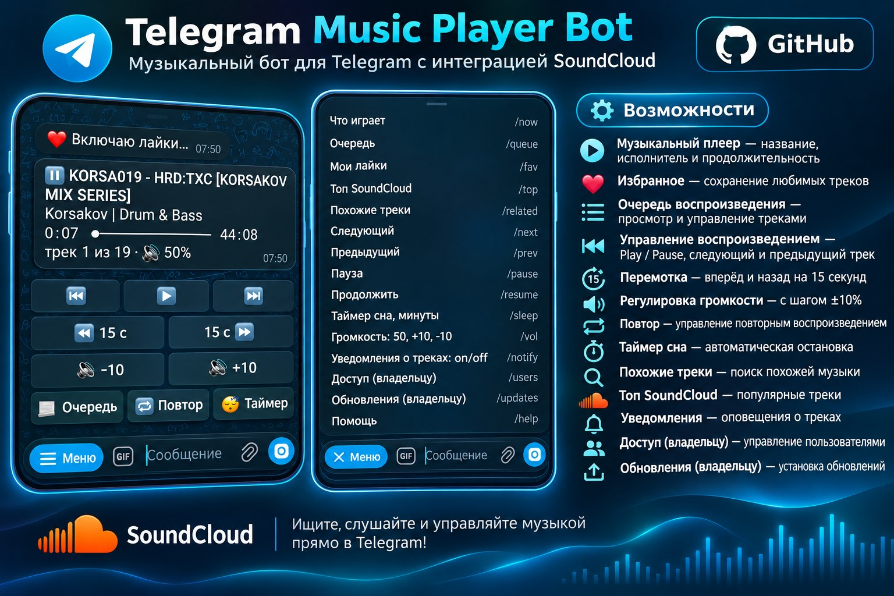
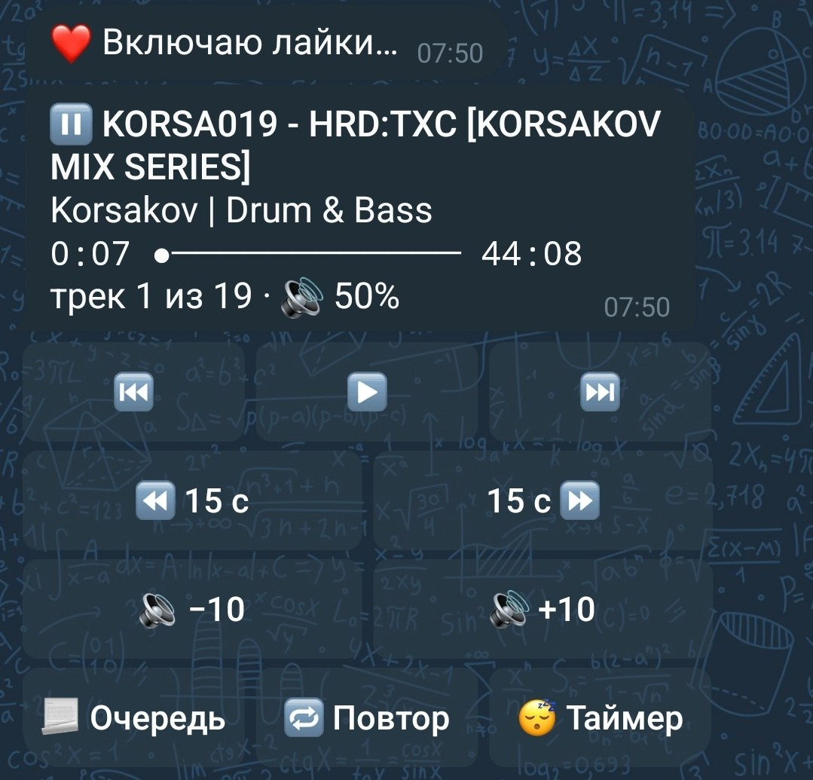
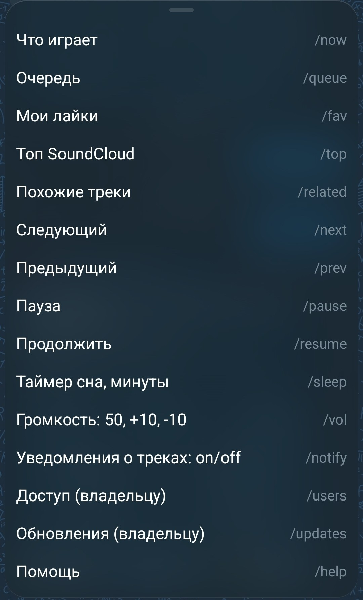

# soundiya-tg

> [!TIP]
> **💰 Поддержать проект** — донат на любой из адресов:
>
> | Сеть | Адрес |
> |---|---|
> | 💵 USDT · TRC20 | `TN2rQAsGNHQr8wnneKRD14UMX629D2Ca5q` |
> | 💵 USDT · ERC20 | `0x721845234eeC44e0a9BaE78402965828C1bc6c57` |
> | 🔸 USDT · TON | `UQCwj-RY2a4BH7sIDDeLb77XRaPDq0mb1FVwyC4UaOGbLMYy` |
> | 💎 TON | `UQCdQtJO4CF0Lyeb93X2zdeWeAcDJ-ieBC3AaL7LIqWfMBg3` |



Telegram-пульт для [soundiya](https://github.com/ShadowBlade83/soundiya) (SoundCloud голосом Алисы) на рутованной **Яндекс Станции Мини 1** (YNDX-0004). Бот работает прямо на колонке и сам ходит в Telegram: **входящих портов нет**.

- Карточка «что играет»: трек, прогресс, громкость, таймер сна; кнопки ⏮ ⏯ ⏭, ±15 с, 🔉/🔊 ±10, 🔁, 😴
- Очередь (до 25 треков): нажал номер — играет этот трек
- Название или ссылка soundcloud.com — найдёт и включит
- 🎙 Голосовое сообщение — колонка проиграет его: музыка встанет на паузу и продолжится после (до 1 минуты и 2 МБ; по умолчанию только владелец)
- Владелец и слушатели: друг пишет боту — тебе приходит запрос ✅/⛔
- Карточку со звуком получает тот, кто включил; `/notify on|off` у каждого свой
- Обновления soundiya: [форк](https://github.com/genaRijoff/soundiya/releases) сам собирает каждую новую версию автора с `STATE`, бот сообщает и ставит по кнопке

<details><summary>Скриншоты</summary>
<p align="center">
  
  
</p>
</details>

> Нужна soundiya с командами `STATE`/`JUMP` — из [релизов форка](https://github.com/genaRijoff/soundiya/releases) (`v…-bot`): каждые 6 часов GitHub Actions переносит наши патчи ([`bot-api`](https://github.com/genaRijoff/soundiya/tree/bot-api)) на новую версию автора, гоняет тесты и выпускает релиз. Скрипт сборки берёт последний такой релиз.

## Что нужно

- Станция Мини 1 с root ([Station Mini Root](https://github.com/hertebeznat-cell/alice-station-1-mini-root)) и SSH или ADB
- Windows 10/11 с WSL (Debian) — для сборки; PowerShell — для установки
- Бот от [@BotFather](https://t.me/BotFather) и свой числовой id ([@userinfobot](https://t.me/userinfobot))

SSH к колонке настраивается один раз в `~\.ssh\config` на ПК (имя `station` используют скрипты):
```
Host station
    HostName <IP колонки>
    Port <порт SSH>
    User root
    IdentityFile ~/.ssh/<твой ключ>
```

## Сборка (WSL, 10–20 минут)

```powershell
git clone https://github.com/genaRijoff/soundiya-tg.git
cd soundiya-tg
wsl -d Debian -- bash scripts/build.sh
```
В `dist\` появятся `soundiya-mini1-bot-*.tar.gz` и `soundiya-tg-armv7-*.tar.gz`. Готовый `soundiya-mini1-bot-*.tar.gz` можно и просто скачать из релизов форка в `dist\`.

## Установка

```powershell
powershell -ExecutionPolicy Bypass -File .\windows\install-soundiya-build.ps1   # soundiya с STATE/JUMP
powershell -ExecutionPolicy Bypass -File .\windows\install-soundiya-tg.ps1      # бот
```
- Первый скрипт ставит soundiya и **выключает её автообновление**, иначе оно вернёт версию автора без `STATE`. Дальше обновления ставит бот: `/updates` или сообщение о новом релизе → **⬇️ Установить**. Файлы проверяет штатный автообновлятор колонки (SHA256, гудок, откат при сбое); вернуть прежнюю сборку — кнопкой.
- Второй при первой установке спросит токен (ввод скрыт, токен не покидает колонку) и твой id. Потом открой бота в Telegram и нажми **Start**.
- Без SSH, по USB: `install-soundiya-build.ps1 -Adb`.

## Управление (на колонке)

| Что | Команда |
|---|---|
| статус | `/data/opt/soundiya-tg/soundiya-tg check` |
| запустить / остановить / перезапустить | `/etc/init.d/S99soundiya-tg start` / `stop` / `restart` |
| лог | `tail -f /tmp/soundiya-tg.log` |
| заново ввести токен и id | `sh /data/opt/soundiya-tg/install.sh setup` |
| обновить | собрать заново и снова `install-soundiya-tg.ps1` (настройки сохраняются) |

## Удаление

```powershell
powershell -ExecutionPolicy Bypass -File .\windows\install-soundiya-tg.ps1 -Uninstall      # бот (настройки остаются)
powershell -ExecutionPolicy Bypass -File .\windows\install-soundiya-build.ps1 -Restore    # официальная soundiya + автообновление
```
Полностью, вместе с токеном и списком слушателей: на колонке `sh /data/opt/soundiya-tg/install.sh uninstall --purge`.

## Команды бота

| Команда | Кто |
|---|---|
| текст или ссылка soundcloud.com — найти и включить | все |
| `/now` `/queue` `/next` `/prev` `/pause` `/resume` | все |
| `/fav` `/top` `/trending [жанр]` `/related` `/playlist` | все |
| `/seek 30` `/sleep 30\|off` `/repeat on\|off` `/vol 50\|+10\|-10` | все |
| `/notify on\|off` — уведомления о новых треках | все |
| `/users`, `/allow ID [имя]`, `/deny ID` — доступ | владелец |
| `/updates` — новые версии soundiya | владелец |

## Настройки

`/data/opt/soundiya-tg/config.json` (права 600; бот не запустится, если файл читают другие). Пример — [`config.example.json`](config.example.json).

| Поле | По умолчанию | |
|---|---|---|
| `token` | — | токен от @BotFather |
| `users` | — | id владельцев |
| `notify` | `true` | новый трек со звуком |
| `updates` | `true` | проверять GitHub раз в 6 ч |
| `github_repo` | `genaRijoff/soundiya` | чьи релизы проверять и ставить |
| `issue_repo` | `ShadowBlade83/soundiya` | где `watch_issue` |
| `watch_issue` | `0` | номер issue, о котором сообщать (0 — выкл.) |
| `voice` | `owners` | кто может слать голосовые: `owners`, `all` (и слушатели; владельцу приходит, кто прислал), `off` |

Слушатели и `/notify` хранятся в `access.json`, проверка обновлений — в `updates.json` (рядом, права 600). После правки: `/etc/init.d/S99soundiya-tg restart`.

## Безопасность

- Только исходящие соединения (long polling), портов на колонке бот не открывает.
- Ответы — только владельцам и одобренным слушателям, только в личке; групповые чаты игнорируются.
- Каждая кнопка проверяется по роли и значению (подделанные callback не проходят).
- Токен: файл 600, в логах и ошибках его нет. Ответы сервисов ограничены по размеру.
- Остаётся: бот работает от root (нужно для сокета soundiya и установки обновлений); твой аккаунт Telegram = права владельца — включи облачный пароль.

## Тесты

```bash
cargo test                                     # модульные
cargo build && mkdir -p /tmp/e2e && for t in basic roles notify outage update voice; do python3 tests/e2e/$t.py target/debug/soundiya-tg /tmp/e2e || break; done   # сквозные (подставные Telegram, GitHub и soundiya)
```

## Лицензия

MIT. soundiya — © ShadowBlade83, MIT.
